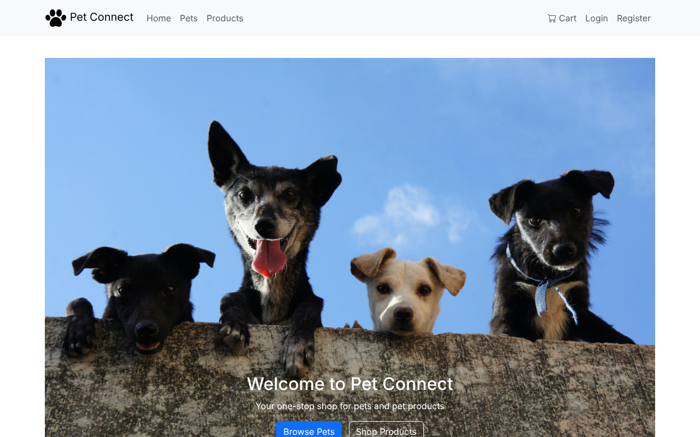
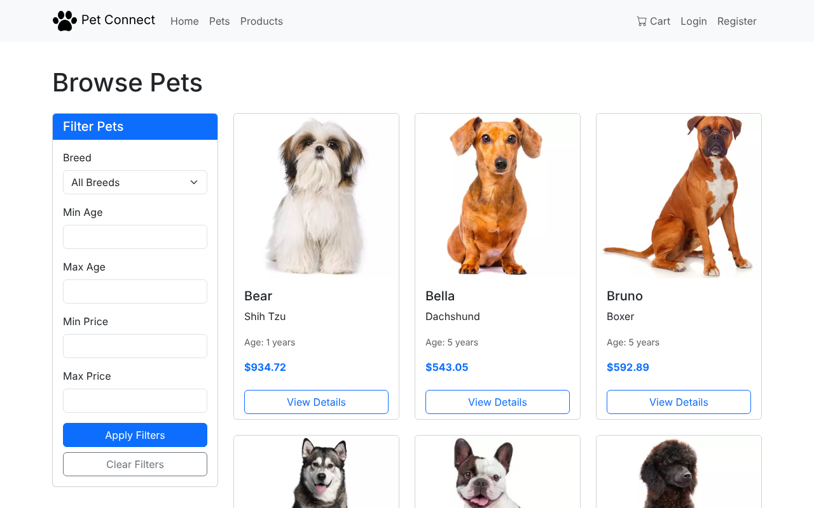
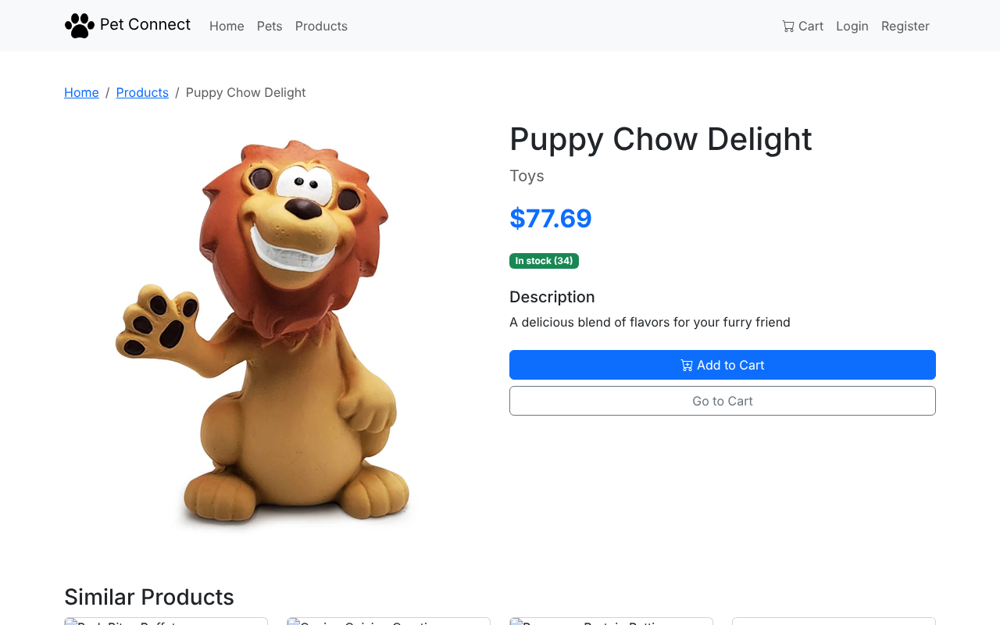

# 🐾 Pet Connect: Pet Adoption & Pet-Supply E-Commerce Platform

A full-stack **Flask + MySQL** web app where customers can browse pets and pet products, manage a cart, check out, and track orders. Admins get a dashboard to manage inventory and fulfil orders.

Built as a team project for **BIS 698 (Spring 2025)**, Group 2.



---

## ✨ Features

| Customers | Admins |
|---|---|
| Browse and search **31 pets** across 30 breeds | Dashboard with pet, product, user and order counts |
| Browse **30 products** by category, with stock levels | Low-stock alerts (stock below 10) |
| Session-based cart for pets and products | Create, edit and delete pets and products |
| Checkout with saved or new addresses and 8% tax | View every order with line items |
| Order history and order detail pages | Update order and delivery status |
| Profile, password change and address book | Admin-only area protected by `before_request` guard |

**Security:** passwords are stored as salted PBKDF2 hashes (`werkzeug.security`), all SQL uses parameterised queries, and credentials load from environment variables.

## 🏗️ Architecture

```
Browser ──► Flask app (app.py)
              ├── routes/main.py      landing page
              ├── routes/auth.py      register / login / logout
              ├── routes/pet.py       pet catalogue + detail
              ├── routes/product.py   product catalogue + detail
              ├── routes/cart.py      session cart + checkout
              ├── routes/user.py      profile, addresses, orders
              └── routes/admin.py     admin dashboard + CRUD
                     │
                     ▼
               MySQL (schema.sql)
```

### Data model

`ROLE` → `USER` → `ADDRESS`, `ORDER` → `ORDERPET` / `ORDERPRODUCT`, `ORDER` → `PAYMENT`, `BREED` → `PET`, `CATEGORY` → `PRODUCT`.
The schema and seed data are in [`schema.sql`](schema.sql).

## 🚀 Getting started

**Prerequisites:** Python 3.10+ and MySQL 8 or MariaDB 10.6+.

```bash
git clone https://github.com/vijay2834/Project_team_2.git
cd Project_team_2
python -m venv .venv && source .venv/bin/activate
pip install -r requirements.txt

# 1. Create the database, load schema + seed data, and write .env
python db_init.py            # interactive
# or: cp .env.example .env, fill it in, then: python db_init.py --from-env

# 2. Run
python run.py                # http://127.0.0.1:5000
```

### Demo accounts (from seed data)

| Role | Email | Password |
|---|---|---|
| Admin | `gfilpi1@slashdot.org` | `oD1#qrLc(@` |
| Customer | `jmaccook0@histats.com` | `dX8+UWZa(mdo` |

Admin login is at `/admin/login`. You can also register a new customer at `/auth/register`.

## ✅ Testing

An end-to-end smoke test covers 30 checks: catalogue pages, registration, login, cart, checkout, order history, admin CRUD and order status updates.

```bash
python tests/smoke_test.py
```

GitHub Actions runs the same test against a MySQL 8 service container on every push (`.github/workflows/ci.yml`).

## 📸 Screenshots

| Pets | Product detail |
|---|---|
|  |  |

The original static UI mockups are kept in [`docs/mockups/`](docs/mockups).

## 🛠️ Tech stack

Python · Flask 2.3 · Flask-MySQLdb · MySQL · Jinja2 · Bootstrap 5 · GitHub Actions

## 📁 Project structure

```
├── app.py / run.py        Flask app factory and entry point
├── config.py              env-driven configuration
├── db_init.py             database bootstrap script
├── schema.sql             DDL + seed data
├── routes/                blueprints (auth, pet, product, cart, user, admin)
├── templates/             Jinja2 templates
├── static/                CSS and images
├── tests/smoke_test.py    end-to-end test
└── docs/                  screenshots and mockups
```
